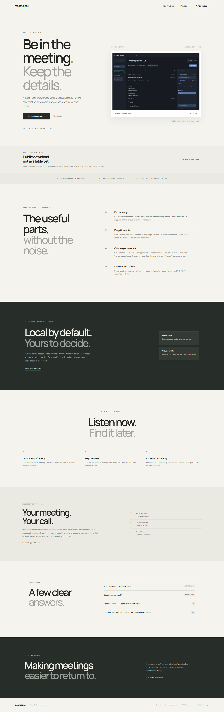

<div align="center">

# Meethelper

**Be in the meeting. Keep the details.**

A clean product site for Meethelper, a local-first meeting notes app for Windows.

[Open the website](https://sanketshinde3001.github.io/meethelper-site/) · [App repository](https://github.com/sanketshinde3001/meethelper)



</div>

## About

This repository contains the static website. It uses semantic HTML and CSS, with no JavaScript framework, analytics or runtime dependencies. The app is in private alpha and does not have a public installer yet.

The Windows app link on the site leads to the release status. It will point to the installer once a public download is available.

## Preview locally

From this folder, run:

```powershell
py -m http.server 8000
```

Open `http://localhost:8000` in a browser.

## License

Website code is available under the [MIT License](LICENSE). The bundled Manrope font is provided under the [SIL Open Font License](assets/fonts/OFL.txt). Product screenshots are sample previews, not app source.
